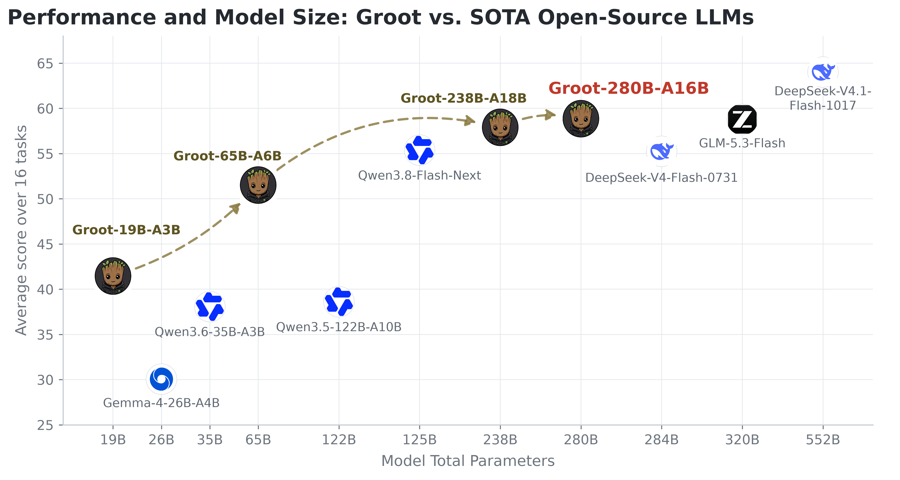
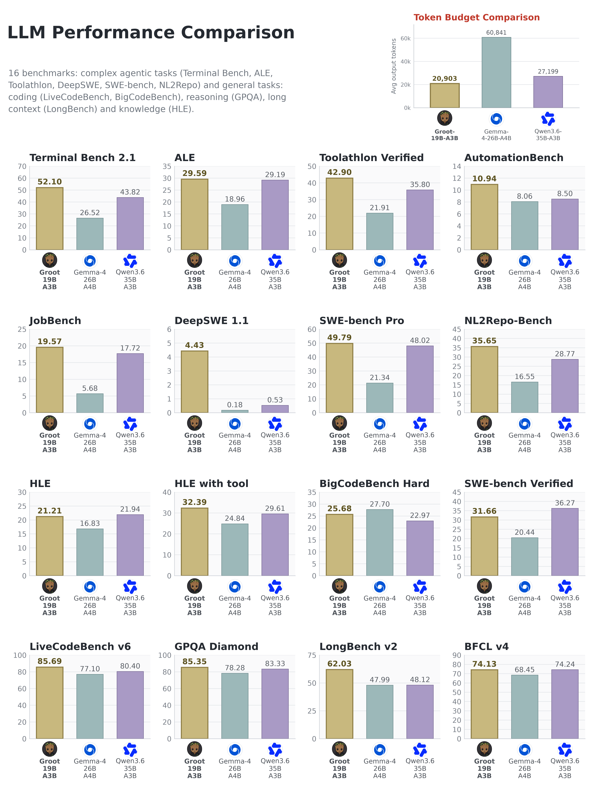
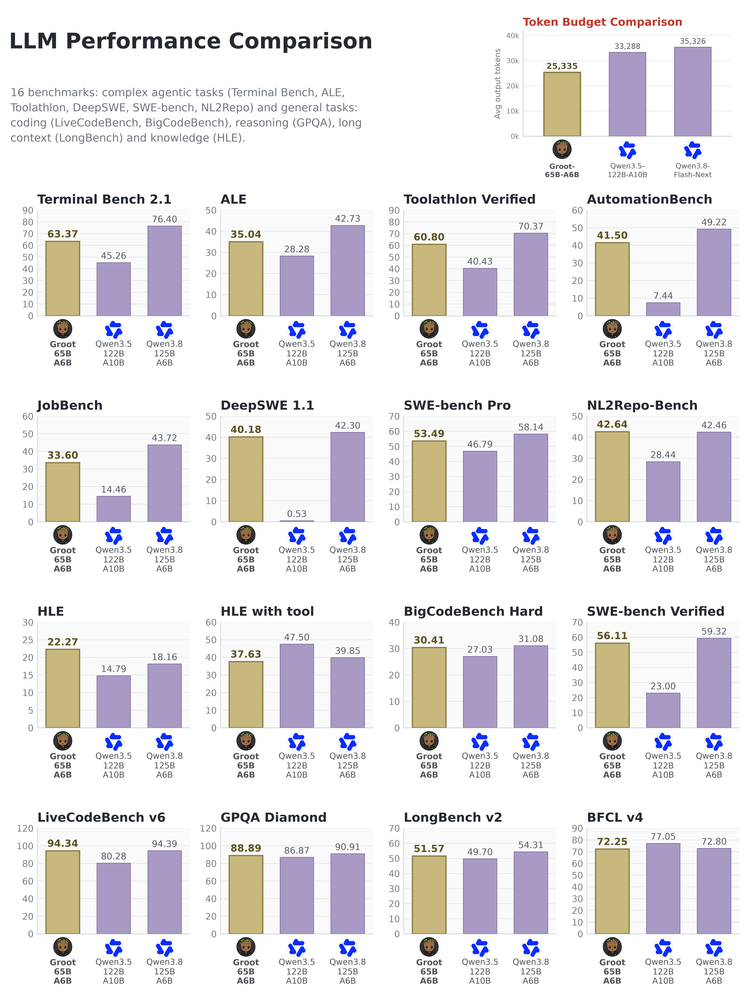

  

<h1 align="center">Smaller models. Serious capabilities.</h1>

  Open-weight reasoning models for coding, tool use, and complex real-world tasks.

  <a href="https://huggingface.co/GrootTeam"><strong>Hugging Face</strong></a>
  &nbsp;·&nbsp;
  <a href="#models">Models</a>
  &nbsp;·&nbsp;
  <a href="#benchmarks">Benchmarks</a>
  &nbsp;·&nbsp;
  <a href="#run-a-model">Run a model</a>
  &nbsp;·&nbsp;
  <a href="https://github.com/GrootTeam/Groot/issues">Feedback</a>

---

We're the **Groot team**. Groot is a family of four open-weight Mixture-of-Experts models built from Qwen, GLM, and DeepSeek models. The goal is simple: make models smaller while keeping the capabilities that matter when there is real work to do.

- **Reasoning:** thinking-mode models evaluated on demanding reasoning and long-context tasks.
- **Coding and agents:** from terminal workflows and repository-level coding to multi-step software engineering tasks.
- **Tool use:** native tool calling, with evaluations covering tool selection, automation, and agentic workloads.

**Small tree. Four weight classes.**

## Models

| Model | Built from | Active parameters / token | Native context |
| :--- | :--- | :--- | :--- |
| [**Groot-19B-A3B**](https://huggingface.co/GrootTeam/Groot-19B-A3B-261023) | Qwen3.6-35B-A3B | ~3B | 256K |
| [**Groot-65B-A6B**](https://huggingface.co/GrootTeam/Groot-65B-A6B-261023) | Qwen3.8-Flash-Next | ~6B | 256K |
| [**Groot-238B-A18B**](https://huggingface.co/GrootTeam/Groot-238B-A18B-261023) | GLM-5.3-Flash | ~18B | 1M |
| [**Groot-280B-A16B**](https://huggingface.co/GrootTeam/Groot-280B-A16B-261023) | DeepSeek-V4.1-Flash-1017 | ~16B decode / ~8B prefill | 1M |

The 19B and 65B models each used **fewer than 100M tokens of open-source data for post-training**. This is post-training on top of the listed base models, not training from scratch.

  

*Our reported evaluations. The vertical axis is an unweighted average across 16 different benchmarks, not an independent leaderboard. Click any chart to view the full-resolution image.*

> **A note on model sizes:** names and plot labels follow the model cards' headline parameter conventions, not complete storage or runtime-memory requirements. The 65B release additionally contains a **51B n-gram lookup table** and **1.4B MTP layer**; the 280B release additionally contains **197B Engram memory** and **14B of MTP/draft layers**. The 19B and 238B models also have additional **0.4B** and **5.6B** MTP layers. Active parameters are not the same as memory usage.

## Benchmarks

A few highlights from **our own 16-benchmark evaluation**. The full per-model charts below include the wins and the losses.

| Model | A result worth looking at |
| :--- | :--- |
| **19B-A3B** | Ahead of both Qwen3.6-35B-A3B and Gemma-4-26B-A4B on **12 / 16 benchmarks**; **52.10** on Terminal Bench 2.1 and **62.03** on LongBench v2. |
| **65B-A6B** | Ahead of Qwen3.5-122B-A10B on **14 / 16 benchmarks**; **63.37** on Terminal Bench 2.1 and **56.11** on SWE-bench Verified. |
| **238B-A18B** | Ahead of both GLM-5.3-Flash and DeepSeek-V4-Flash-0731 on **six agentic benchmarks**; **65.13** on DeepSWE 1.1 and **50.18** on NL2Repo-Bench. |
| **280B-A16B** | Ahead of those same two models on **8 / 16 benchmarks**; **56.71** on NL2Repo-Bench and **63.47** on SWE-bench Pro. |

Across the 16 evaluation runs, **19B uses 23.1% fewer output tokens** on average than Qwen3.6-35B-A3B, and **65B uses 28.3% fewer** than Qwen3.8-Flash-Next. These are output-token comparisons, **not measured latency or throughput improvements**.

<strong>Groot-19B-A3B — full results and output-token comparison</strong>

[Model card and evaluation settings](https://huggingface.co/GrootTeam/Groot-19B-A3B-261023#benchmarks)

<strong>Groot-65B-A6B — full results and output-token comparison</strong>

[Model card and evaluation settings](https://huggingface.co/GrootTeam/Groot-65B-A6B-261023#benchmarks)

<strong>Groot-238B-A18B — full results and output-token comparison</strong>

[Model card and evaluation settings](https://huggingface.co/GrootTeam/Groot-238B-A18B-261023#benchmarks)

<strong>Groot-280B-A16B — full results and output-token comparison</strong>

[Model card and evaluation settings](https://huggingface.co/GrootTeam/Groot-280B-A16B-261023#benchmarks)

**How to read the results.** Agent scaffolds, context limits, reasoning effort, and sampling settings differ by benchmark and model. The linked cards document those settings. These results are not across-the-board wins over the base models; for example, the 65B model's suite average is **51.51**, below Qwen3.8-Flash-Next's **55.39**. Hardware-fit examples in the cards are capacity estimates, not a substitute for testing your own workload.

## Run a model

The weights live on **[Hugging Face](https://huggingface.co/GrootTeam)**. This repository is the model-family homepage; it does not contain model weights or a separate inference engine.

| Model | Available weights | Model-specific setup |
| :--- | :--- | :--- |
| **19B-A3B** | [BF16](https://huggingface.co/GrootTeam/Groot-19B-A3B-261023) · [FP8](https://huggingface.co/GrootTeam/Groot-19B-A3B-261023-FP8) · [NVFP4](https://huggingface.co/GrootTeam/Groot-19B-A3B-261023-NVFP4) · [GGUF](https://huggingface.co/GrootTeam/Groot-19B-A3B-261023-GGUF) | [Quickstart](https://huggingface.co/GrootTeam/Groot-19B-A3B-261023#quickstart) |
| **65B-A6B** | [BF16](https://huggingface.co/GrootTeam/Groot-65B-A6B-261023) · [FP8](https://huggingface.co/GrootTeam/Groot-65B-A6B-261023-FP8) · [NVFP4](https://huggingface.co/GrootTeam/Groot-65B-A6B-261023-NVFP4) · [GGUF](https://huggingface.co/GrootTeam/Groot-65B-A6B-261023-GGUF) | [Quickstart](https://huggingface.co/GrootTeam/Groot-65B-A6B-261023#quickstart) |
| **238B-A18B** | [FP8](https://huggingface.co/GrootTeam/Groot-238B-A18B-261023) · [GGUF](https://huggingface.co/GrootTeam/Groot-238B-A18B-261023-GGUF) | [Quickstart](https://huggingface.co/GrootTeam/Groot-238B-A18B-261023#quickstart) |
| **280B-A16B** | [FP8 / FP4 experts](https://huggingface.co/GrootTeam/Groot-280B-A16B-261023) · [GGUF](https://huggingface.co/GrootTeam/Groot-280B-A16B-261023-GGUF) | [Quickstart](https://huggingface.co/GrootTeam/Groot-280B-A16B-261023#quickstart) |

Use the **`GrootTeam/...` repository IDs** linked above in your runtime configuration. Consult the corresponding card for runtime versions, reasoning/tool parsers, sampling settings, and memory requirements. The listed native context windows are model capabilities, not guarantees that every hardware configuration can serve that length.

## Feedback

Tried Groot on something real? We'd like to hear about it—especially the parts a benchmark doesn't tell us.

[Open an issue](https://github.com/GrootTeam/Groot/issues) with the model and quantization, runtime version, hardware, context length, and a reproducible example where possible. Please leave out credentials and private data.

## Acknowledgements and model terms

Groot builds on the work of the **Qwen, GLM, and DeepSeek teams**, as well as the open-source evaluation and serving communities.

Model terms are model-specific: the 19B card lists **Apache 2.0**, the 65B card lists **Qwen Community 1.0**, and the 238B and 280B cards list **MIT**. Refer to each linked model card and its upstream terms before use. This homepage does not relicense the underlying models.
